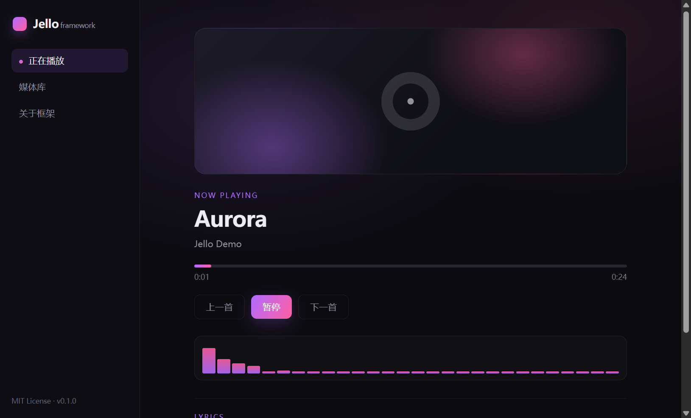

# Jello Music Framework

A clean, MIT-licensed desktop **music playback framework** built with Electron 45, Vue 3 and Vite 8.

The framework owns the parts every desktop player rewrites: the window shell, playback state,
queue handling, lyrics, spectrum visualization and the security boundary between the renderer and
the outside world. **What to play is supplied by a data-source adapter**, not by this repository.

This repository contains **no music content, no bundled audio files, no third-party music API and
no provider-specific SDK**. The built-in demo source synthesizes a short chord locally so the
framework runs out of the box.

## Preview



## Status

Early skeleton (v0.1.0). The playback shell, demo source, adapter contract, tests and packaging
configuration are in place. Real catalog/search features are intentionally left to adapters.

## Features

- Electron 45 + Vue 3 + Vite 8, packaged with electron-builder
- Secure main/renderer split: `contextIsolation`, `sandbox`, no Node.js in the renderer
- Deny-by-default window opening and navigation
- `MusicSource` adapter contract with a local `DemoSource`
- Playback queue, progress, seeking and track switching
- Desktop-style UI with lyrics and a live spectrum analyser (Web Audio)
- `node:test` coverage for the demo adapter
- MIT licensed

## Requirements

- Node.js >= 20.19
- Windows, macOS or Linux for development

## Quick start

```sh
npm install
npm run build
npm start        # opens the Electron window
```

Renderer-only development:

```sh
npm run dev      # Vite dev server, open the printed URL in a browser
```

Tests and packaging:

```sh
npm test
npm run dist     # Windows NSIS installer, output in dist_electron/
```

## Architecture

```text
┌──────────────────────────────────────────────┐
│ Electron main process (electron/main.cjs)    │
│  window lifecycle · IPC allowlist · security │
└───────────────┬──────────────────────────────┘
                │ contextBridge (preload.cjs)
┌───────────────▼──────────────────────────────┐
│ Renderer (Vue 3)                             │
│  App.vue · player state · lyrics · spectrum  │
└───────────────┬──────────────────────────────┘
                │ MusicSource contract
┌───────────────▼──────────────────────────────┐
│ Data source adapter (src/sources)            │
│  DemoSource: local synthesized audio         │
│  YourSource: library / files / lawful API    │
└──────────────────────────────────────────────┘
```

See [docs/ARCHITECTURE.md](docs/ARCHITECTURE.md) for the data flow and the adapter contract.

## Adding a data source

1. Implement `MusicSource` from `src/sources/MusicSource.js`:

```js
import { MusicSource } from './MusicSource.js';

export class MySource extends MusicSource {
  async listTracks() {
    return [{ id: 'track-1', title: 'My track', artist: 'Me', duration: 180 }];
  }

  async search(query) {
    return (await this.listTracks()).filter((track) => track.title.includes(query));
  }

  async resolveStream(track) {
    return { kind: 'url', url: 'https://example.com/audio.mp3' };
  }
}
```

2. Replace `new DemoSource()` in `src/composables/usePlayer.js` with your adapter.
3. If your source returns `kind: 'url'`, extend the playback layer to use an `HTMLAudioElement`
   or your own media backend. The demo player only understands local synthesized tones.

Adapters are responsible for their own authentication, rate limits, terms of service and content
rights. Do not ship credentials or copyrighted media in the renderer.

## Security baseline

- The renderer has no Node.js access and runs with `sandbox: true`.
- New windows and cross-origin navigation are denied by the main process.
- A strict Content-Security-Policy is declared in `index.html`.
- Only the `app:info` IPC channel is exposed through the preload bridge.
- No remote content is loaded by default; the demo adapter is fully local.

## What this project is not

- It does not provide, host, proxy or distribute music.
- It does not include or wrap any third-party music service API.
- It does not bypass DRM or access controls.
- It is not affiliated with any music platform.

Use it as a starting point for a player you have the right to build.

## License

[MIT](LICENSE) © 2026 Margele1337
